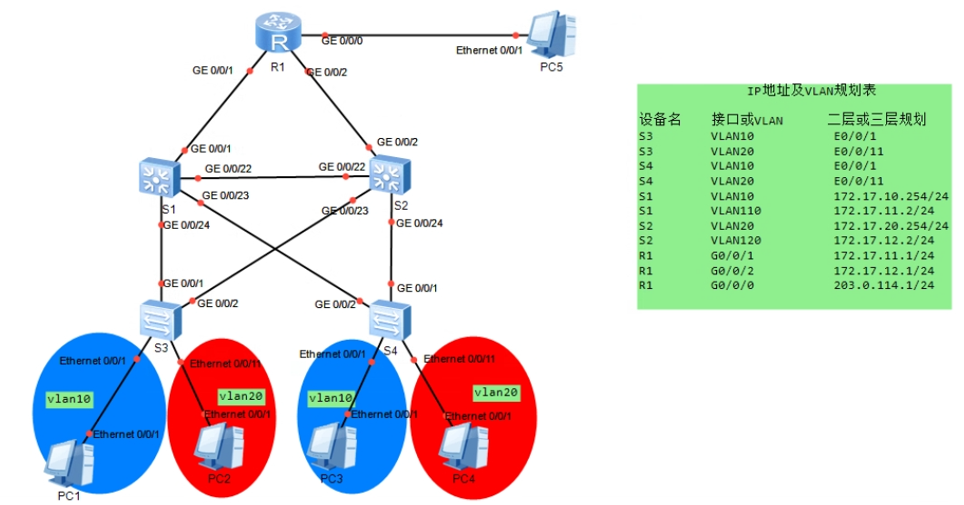

# 初赛试题1
## 一、说明：此题需完成并上交以下文档：
上交ans文件，命名为：考号-姓名.ans

## 二、ENSP中模拟一个小型公司B的网络拓扑，请按照下述需求，完成具体配置：



### 1、基础配置
根据IP地址及VLAN规划表，为相关路由器、交换机等设备配置：主机名（字母大小写，需与拓扑图上的主机名一致）、IP地址和VLAN。

|设备名|接口或VLAN|二层或三层规划|
| ---- | ---- | ---- |
|R1|G0/0/1|172.17.11.1/24|
|R1|G0/0/2|172.17.12.1/24|
|R1|G0/0/0|203.0.114.1/24|
|S1|Vlan 10|172.17.10.254/24|
|S1|Vlan 110|172.17.11.2/24|
|S2|Vlan 20|172.17.20.254/24|
|S2|Vlan 120|172.17.12.2/24|
|S3|VLAN10|E0/0/1|
|S3|VLAN20|E0/0/11|
|S4|VLAN10|E0/0/1|
|S4|VLAN20|E0/0/11|

### 2、Vlan配置
根据IP地址及VLAN规划表完成各交换机的vlan划分，交换机和交换机相连的接口配置为trunk，允许必要的vlan通过。

### 3、MSTP配置
在交换机S1、S2、S3、S4上配置MSTP防止二层环路；要求VLAN10数据流经过S1转发；VLAN20数据流经过S2转发。所配置的参数要求如下：
region-name:huawei
revision版本:1
实例1包含VLAN10，实例2包含VLAN20
优先级只能为4096或8192

### 4、OSPF配置
R1、S1、S2之间运行ospf，宣告接口地址，其中R1的router-id为1.1.1.1，S1的router-id为11.11.11.11，S2的router-id为22.22.22.22。

### 5、静态路由配置
PC5模拟外网，S1、S2上分别配置访问外网的默认路由。

### 6、NAT配置
在R1上配置Easy-IP，让内网所有私有地址通过203.0.114.1访问公网，注意：ACL编号为2000

---

# 整体说明（eNSP 华为VRP5，交换机为S5700，路由器AR2220）
> 拓扑逻辑梳理：
> - S1、S2是**三层交换机**（做VLANIF，跑OSPF）；S3、S4是**二层接入交换机**，只划分VLAN、配Trunk，不配置三层IP、不跑OSPF
> - MSTP需求：
>   - MST域：`huawei`，revision 1
>   - Instance1：VLAN10，**S1优先级4096（主），S2优先级8192（备）**
>   - Instance2：VLAN20，**S2优先级4096（主），S1优先级8192（备）**
> - Trunk放行：VLAN10、20、110、120
> - Easy-IP：R1，ACL 2000匹配内网，出接口G0/0/0，公网地址203.0.114.1
> - PC5（外网）：203.0.114.2/24，网关203.0.114.1

---
## 一、R1（AR2220）
```shell
sysname R1
# 关闭信息提示（可选）
undo info-center enable

# 配置接口IP
interface GigabitEthernet 0/0/0
 ip address 203.0.114.1 255.255.255.0
# 连接S1（VLAN110网段）
interface GigabitEthernet 0/0/1
 ip address 172.17.11.1 255.255.255.0
# 连接S2（VLAN120网段）
interface GigabitEthernet 0/0/2
 ip address 172.17.12.1 255.255.255.0

# OSPF配置，router-id 1.1.1.1
ospf 1 router-id 1.1.1.1
 area 0
  network 172.17.11.0 0.0.0.255
  network 172.17.12.0 0.0.0.255
  network 203.0.114.0 0.0.0.255

# NAT Easy-IP，ACL 2000匹配所有内网网段
acl number 2000
 rule permit source 172.17.10.0 0.0.0.255
 rule permit source 172.17.20.0 0.0.0.255
 rule permit source 172.17.11.0 0.0.0.255
 rule permit source 172.17.12.0 0.0.0.255

interface GigabitEthernet 0/0/0
 nat outbound 2000
```
✅讲解：
1. G0/0/0为公网口，对接外网PC5；G0/0/1接S1的VLANIF110网段，G0/0/2接S2的VLANIF120网段
2. OSPF宣告所有直连网段，区域0骨干域
3. Easy-IP：直接复用G0/0/0接口地址做PAT，ACL2000匹配所有内网私网流量

---
## 二、S1（S5700 三层交换机）
```shell
sysname S1
undo info-center enable

# 创建VLAN
vlan batch 10 20 110 120

# 三层VLANIF
interface Vlanif 10
 ip address 172.17.10.254 255.255.255.0
interface Vlanif 110
 ip address 172.17.11.2 255.255.255.0

# 【接口配置】
# G0/0/1 对接R1 G0/0/1，属于VLAN110
interface GigabitEthernet 0/0/1
 port link-type access
 port default vlan 110

# G0/0/22 <-> S2 G0/0/22 Trunk互联
interface GigabitEthernet 0/0/22
 port link-type trunk
 port trunk allow-pass vlan 10 20 110 120

# G0/0/24 <-> S3 G0/0/1 Trunk
interface GigabitEthernet 0/0/24
 port link-type trunk
 port trunk allow-pass vlan 10 20

# G0/0/23 <-> S4 G0/0/2 Trunk
interface GigabitEthernet 0/0/23
 port link-type trunk
 port trunk allow-pass vlan 10 20

# MSTP配置
stp region-configuration
 region-name huawei
 revision-level 1
 instance 1 vlan 10
 instance 2 vlan 20
 active

# MST实例优先级：实例1（VLAN10）4096，实例2（VLAN20）8192
stp instance 1 root primary
# 等价于 stp instance 1 priority 4096
stp instance 2 priority 8192

# OSPF router-id 11.11.11.11
ospf 1 router-id 11.11.11.11
 area 0
  network 172.17.10.0 0.0.0.255
  network 172.17.11.0 0.0.0.255

# 默认路由指向R1，访问外网
ip route-static 0.0.0.0 0.0.0.0 172.17.11.1
```
✅讲解：
1. VLAN10是业务网关，VLAN110是S1和R1互联网段
2. MST：实例1 VLAN10 S1为主根桥；实例2 VLAN20 S1为备用
3. 所有交换机之间互联口为Trunk；对接路由器的口是Access划入VLAN110
4. 默认路由下一跳指向R1的172.17.11.1，所有未知流量发给R1，由R1做NAT上外网

---
## 三、S2（S5700 三层交换机）
```shell
sysname S2
undo info-center enable

vlan batch 10 20 110 120

# 三层VLANIF
interface Vlanif 20
 ip address 172.17.20.254 255.255.255.0
interface Vlanif 120
 ip address 172.17.12.2 255.255.255.0

# G0/0/2 对接R1 G0/0/2，划入VLAN120
interface GigabitEthernet 0/0/2
 port link-type access
 port default vlan 120

# G0/0/22 <-> S1 G0/0/22 Trunk
interface GigabitEthernet 0/0/22
 port link-type trunk
 port trunk allow-pass vlan 10 20 110 120

# G0/0/23 <-> S3 G0/0/2 Trunk
interface GigabitEthernet 0/0/23
 port link-type trunk
 port trunk allow-pass vlan 10 20

# G0/0/24 <-> S4 G0/0/1 Trunk
interface GigabitEthernet 0/0/24
 port link-type trunk
 port trunk allow-pass vlan 10 20

# MSTP配置（和S1同域，参数必须一致！）
stp region-configuration
 region-name huawei
 revision-level 1
 instance 1 vlan 10
 instance 2 vlan 20
 active

# MST优先级：实例1（VLAN10）8192；实例2（VLAN20）4096（主根桥）
stp instance 1 priority 8192
stp instance 2 root primary

# OSPF router-id 22.22.22.22
ospf 1 router-id 22.22.22.22
 area 0
  network 172.17.20.0 0.0.0.255
  network 172.17.12.0 0.0.0.255

# 默认路由指向R1
ip route-static 0.0.0.0 0.0.0.0 172.17.12.1
```
✅讲解：
1. VLAN20业务网关，VLAN120是S2与R1互联网段
2. MST实例2 VLAN20，S2为主根桥，VLAN20流量优先走S2转发，满足题目要求
3. MST域配置必须和S1完全一样（名字、revision、vlan映射），否则不在同一个MST域，MSTP失效

---
## 四、S3（二层接入交换机，只做VLAN+Trunk，无三层、无OSPF）
```shell
sysname S3
undo info-center enable

vlan batch 10 20

# E0/0/1：VLAN10 PC接入
interface Ethernet 0/0/1
 port link-type access
 port default vlan 10

# E0/0/11：VLAN20 PC接入
interface Ethernet 0/0/11
 port link-type access
 port default vlan 20

# G0/0/1 ← S1 G0/0/24 Trunk
interface GigabitEthernet 0/0/1
 port link-type trunk
 port trunk allow-pass vlan 10 20

# G0/0/2 ← S2 G0/0/23 Trunk
interface GigabitEthernet 0/0/2
 port link-type trunk
 port trunk allow-pass vlan 10 20

# MSTP（同域，必须配置，否则环路防不住！二层交换机也要加入MST域）
stp region-configuration
 region-name huawei
 revision-level 1
 instance 1 vlan 10
 instance 2 vlan 20
 active
```
✅讲解：
S3是纯二层，两条上行分别到S1、S2，MSTP自动按实例阻断冗余链路：
- VLAN10：上行S1为转发，到S2链路阻塞
- VLAN20：上行S2为转发，到S1链路阻塞

---
## 五、S4（二层接入交换机，同S3逻辑）
```shell
sysname S4
undo info-center enable

vlan batch 10 20

# E0/0/1：VLAN10 PC接入
interface Ethernet 0/0/1
 port link-type access
 port default vlan 10

# E0/0/11：VLAN20 PC接入
interface Ethernet 0/0/11
 port link-type access
 port default vlan 20

# G0/0/1 ← S2 G0/0/24 Trunk
interface GigabitEthernet 0/0/1
 port link-type trunk
 port trunk allow-pass vlan 10 20

# G0/0/2 ← S1 G0/0/23 Trunk
interface GigabitEthernet 0/0/2
 port link-type trunk
 port trunk allow-pass vlan 10 20

# MSTP域配置，和其他交换机保持一致
stp region-configuration
 region-name huawei
 revision-level 1
 instance 1 vlan 10
 instance 2 vlan 20
 active
```

---
# 六、PC地址规划（供你eNSP里填）
|设备|IP|掩码|网关|
| ---- | ---- | ---- | ---- |
|VLAN10 PC|172.17.10.10/24|255.255.255.0|172.17.10.254|
|VLAN20 PC|172.17.20.10/24|255.255.255.0|172.17.20.254|
|PC5外网|203.0.114.2/24|255.255.255.0|203.0.114.1|

# 七、验证命令（做完必敲）
```shell
# MSTP查看
display stp region-configuration
display stp instance 1 brief
display stp instance 2 brief

# OSPF
display ospf peer
display ip routing-table

# NAT
display nat outbound
display acl 2000
```

# 八、重点坑提醒（eNSP高频踩坑）
1. MST域**region-name、revision、vlan-instance映射，四台交换机必须完全一样**，少一个字符就分域，形成环路
2. root primary 自动设置优先级4096；题目优先级只允许4096/8192，上面脚本严格遵守
3. S1/S2之间Trunk需要放行110、120，否则OSPF邻居断
4. 接入交换机S3/S4只放行业务VLAN10、20即可，不需要110、120
5. Easy-IP的ACL不要写反，只匹配内网，不要包含公网网段

如果你想要，我可以再给你一份**排错步骤+每一步预期现象**，方便你写实验报告。